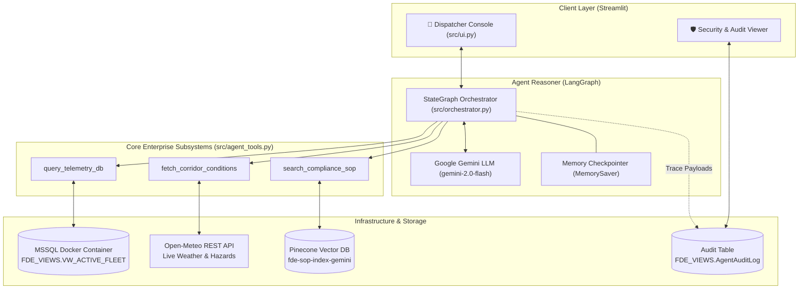
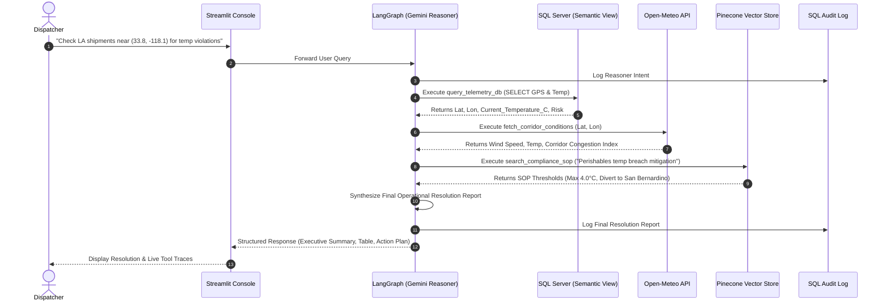
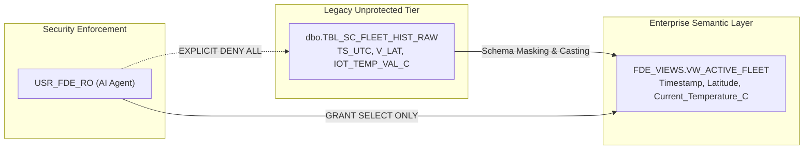
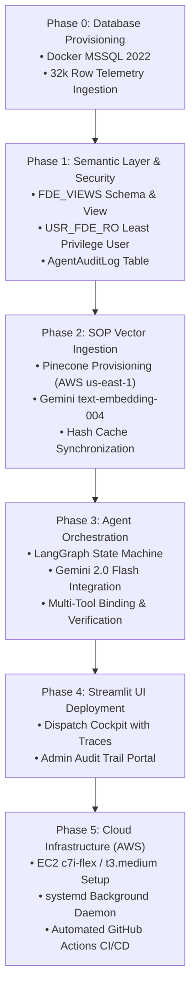

# 🧊 Cold-Chain Logistics Incident Control System
> **Forward Deployed Engineering (FDE) Platform for Real-Time Telemetry Decision Support**

[](https://ai.google.dev/)
[](https://www.pinecone.io/)
[](https://www.langchain.com/langgraph)
[](https://www.microsoft.com/sql-server)
[-success.svg)](http://18.234.59.239:8501)

---

## 📌 1. Project Overview

In cold-chain supply chains, transporting perishable goods (produce, pharmaceuticals, frozen foods) requires strict thermal and transit monitoring. A single temperature spike beyond 4.0°C or an unexpected port congestion delay can cause severe spoilage, regulatory fines, and contractual SLA breaches.

This project delivers an **autonomous Forward Deployed Engineering (FDE) operational platform** that empowers logistics dispatchers and supply chain commanders to **"chat with their live data"**. The system continuously monitors vehicle IoT telemetry, correlates transit corridors with live atmospheric hazard data, and enforces company Standard Operating Procedures (SOPs) to recommend decisive mitigations.

### Key Capabilities:
* **Natural Language Fleet Analytics:** Dispatchers ask questions in plain English to inspect live shipments and telemetry anomalies.
* **Corridor Hazard Correlation:** Automatically queries live meteorological APIs (temperature, wind speeds, disruption indexes) for vehicles in transit.
* **SOP-Driven Compliance:** Semantic vector retrieval across enterprise Standard Operating Procedures to guide cooling adjustments and route diversions.
* **Semantic Layer Virtualization:** Abstracts legacy database schemas into clean business views while enforcing strict least-privilege security.
* **Dual-Interface Command Console:** Streamlit dispatch cockpit featuring live step-by-step agent reasoning traces and an enterprise administrative audit log viewer.

---

## 🏗️ 2. System Architecture



---

## 🔄 3. End-to-End Decision Pipeline

The diagram below illustrates how an incoming dispatcher query triggers a coordinated multi-step evaluation across telemetry, live weather, and compliance rules:



---

## 🛡️ 4. Data Security & Least-Privilege Architecture

Enterprises cannot expose production transactional databases directly to LLMs without guardrails. This project enforces a three-tier security and semantic layer:



* **No Direct Raw Table Access:** `DENY SELECT, INSERT, UPDATE, DELETE ON dbo` ensures the LLM cannot mutate or read raw unvalidated tables.
* **Semantic Translation:** Cryptic column abbreviations (`PRT_CNG_LVL`, `RT_RSK_IDX`) are converted into human-intelligible fields (`Port_Congestion_Level`, `Route_Risk_Index`).
* **Audit Trail Governance:** Every reasoning step, parameter payload, and synthesized output is committed to `FDE_VIEWS.AgentAuditLog`.

---

## 📋 5. Implementation Plan



---

## 🔑 6. Required API Keys & Setup Guide

To run or deploy this project, you need the following keys. Here is exactly how to acquire each:

### 1. Google Gemini API Key (`GOOGLE_API_KEY`)
* **Purpose:** Powers the core LLM reasoning engine (`gemini-2.0-flash`) and vector embeddings (`models/text-embedding-004`).
* **How to get it:**
  1. Visit [Google AI Studio](https://aistudio.google.com/).
  2. Sign in with your Google account.
  3. Click **"Get API key"** in the top left navigation.
  4. Click **"Create API key"** in a new or existing Google Cloud project.
  5. Copy your API key.

### 2. Pinecone API Key (`PINECONE_API_KEY`)
* **Purpose:** Hosts the serverless vector database index for Standard Operating Procedures.
* **How to get it:**
  1. Visit [Pinecone Console](https://app.pinecone.io/) and create a free account.
  2. In the left navigation, click on **API Keys**.
  3. Copy your default API key (or click **"Create API Key"**).
  * *Note:* The index `fde-sop-index-gemini` (dimension 768) is automatically created by `scripts/ingest_sop_pinecone.py` on AWS `us-east-1`.

### 3. AWS Credentials (For EC2 Deployment)
* **Purpose:** Hosts the Microsoft SQL Server container and runs the Streamlit production daemon.
* **Requirements:**
  1. An active [AWS Console](https://aws.amazon.com/) account.
  2. An EC2 instance running Ubuntu Server 22.04 / 24.04 (`t3.medium` or `c7i-flex.large`).
  3. Your EC2 SSH Key Pair (`.pem` file) and Public IPv4 address.
  4. Ensure your EC2 **Security Group** allows inbound traffic on:
     * Port `22` (SSH)
     * Port `1433` (MSSQL)
     * Port `8501` (Streamlit Web UI)

---

## ⚙️ 7. Quickstart Guide (Local Execution)

### Step 1: Clone or Navigate to the Folder
```bash
cd "C:\Users\ASUS\Desktop\AI Project"
```

### Step 2: Install Python Dependencies
```bash
python -m venv venv
# Windows:
.\venv\Scripts\activate
# Linux/Mac:
source venv/bin/activate

pip install -r requirements.txt
```

### Step 3: Configure Environment Variables
Copy `.env.example` to `.env` and fill in your keys:
```bash
cp .env.example .env
```
Populate:
```env
GOOGLE_API_KEY=AIzaSy...
PINECONE_API_KEY=pcsk_...
AGENT_LLM=GEMINI
GEMINI_MODEL=gemini-3.8-flash
EMBEDDINGS_MODEL=GEMINI
GEMINI_EMBEDDING_MODEL=models/gemini-embedding-001
```

### Step 4: Start SQL Server in Docker
Ensure Docker Desktop is running on your machine:
```bash
docker run -v mssql_data:/var/opt/mssql -e "ACCEPT_EULA=Y" -e "MSSQL_SA_PASSWORD=FdeEnterprisePass123!" -p 1433:1433 --name legacy-mssql --restart always -d mcr.microsoft.com/mssql/server:2022-latest
```

### Step 5: Ingest Telemetry Data
```bash
python scripts/ingest_legacy_data.py
```

### Step 6: Create Security & Semantic Views
Apply the enterprise security layer, semantic views, and audit log table:
```bash
python scripts/apply_security_views.py
```

### Step 7: Ingest SOPs to Pinecone
```bash
python scripts/ingest_sop_pinecone.py
```

### Step 8: Verify End-to-End Pipeline
Run the full verification suite testing database permissions, Pinecone vector search, weather REST API, and Gemini reasoning:
```bash
python scripts/verify_agent_pipeline.py
```

### Step 9: Launch the Dispatch Console
```bash
streamlit run src/ui.py
```
Open your browser at `http://localhost:8501`.

---

## ☁️ 8. Live AWS EC2 Cloud Deployment

The application is deployed on an **AWS EC2 Ubuntu 26.04** instance with Docker, SQL Server 2022, and a systemd background service:

* **Live URL:** [`http://18.234.59.239:8501`](http://18.234.59.239:8501)
* **Instance ID:** `i-07ceb9a6ab5cd74e6`
* **Public IPv4:** `18.234.59.239`
* **Architecture:** `t3.micro` + 4 GB Linux swap file + memory interception shim (`fake_meminfo.so`) for SQL Server 2022.
* **Service Status:** Systemd managed (`streamlit.service`), auto-restarting on reboot.
* **Admin Audit Portal Credentials:**
  * Username: `sa`
  * Password: `FdeEnterprisePass123!`

---

## 📂 8. Project File Structure

```
AI Project/
├── .github/
│   └── workflows/
│       └── deploy.yml              # Automated GitHub Actions deployment to EC2
├── .streamlit/
│   └── config.toml                 # Streamlit server & theme configuration
├── data/
│   ├── cache/
│   │   └── ingestion_hash_cache.json # MD5 vector ingestion hash tracker
│   ├── policy/
│   │   └── Cold_Chain_Incident_SOP_v2.md # Regulatory compliance SOPs
│   ├── raw/
│   │   └── dynamic_supply_chain_logistics_dataset.csv # 32k raw telemetry records
│   └── source/
│       └── data.txt                # Kaggle dataset reference link
├── deploy/
│   ├── setup_ec2.sh                # Automated AWS EC2 instance provisioning
│   └── streamlit.service           # systemd background daemon service unit
├── docs/
│   └── instructions.md             # Detailed phase-by-phase operational manual
├── scripts/
│   ├── ingest_legacy_data.py       # Loads raw dataset into MSSQL
│   ├── ingest_sop_pinecone.py      # Chunks & indexes SOPs into Pinecone with Gemini
│   └── setup_security_and_view.sql # Semantic views, audit table & RBAC rules
├── src/
│   ├── prompts/
│   │   └── system_prompt.txt       # Persona & structured business output template
│   ├── agent_tools.py              # Telemetry SQL, Weather REST, and SOP retriever
│   ├── orchestrator.py             # LangGraph state machine powered by Gemini
│   └── ui.py                       # Streamlit Dispatch Cockpit & Audit Portal
├── .env.example                    # Template environment variables
├── requirements.txt                # Project dependencies (LangChain, Gemini, etc.)
└── README.md                       # Comprehensive project documentation
```
